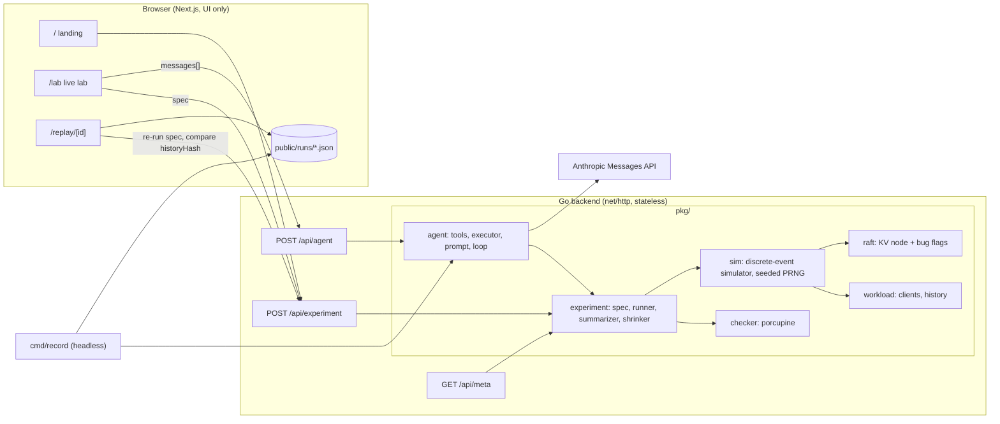

# Quorum

An AI that tries to break your distributed system.

Quorum is a Jepsen-style testing lab where Claude plays the adversary. A simulated five-node Raft key-value cluster runs inside a deterministic simulator written in Go. Some cluster variants ("targets") contain a planted, realistic consistency bug; one is correct. Claude does not know which bug, if any, is planted. It sees the cluster only as a black box.

Claude's job is to break it. It forms a hypothesis about how the system might violate linearizability, designs a fault schedule (partitions, crashes, restarts, process pauses, latency), runs the experiment, and reads the verdict of a real linearizability checker. Then it refines the hypothesis and repeats. When it finds a violation, it shrinks the fault schedule to a minimal reproduction and writes a finding that explains the causal chain. On the correct target it should conclude, once its budget is spent, that it found no violation.

**The checker is the ground truth.** Claude can never claim a bug the checker has not confirmed.

You watch all of this live in the browser: Claude's reasoning, the cluster topology changing under faults, and a timeline of every client operation with the violating operations highlighted.

## Architecture



- **Go owns everything that computes**: the simulator, Raft, the workload, the checker, experiments and shrinking, the agent loop, the Anthropic calls, and all `/api/*` endpoints. Handlers in `api/` are thin, one file per endpoint, and delegate to `pkg/`.
- **Next.js is UI only.** It has no API routes, route handlers or server actions. In development, `next.config.ts` rewrites `/api/*` to the Go dev server on `127.0.0.1:8080`.
- **Every request is self-contained.** There is no database, no shared in-memory state and no filesystem writes, and no goroutines outlive the request.

The HTTP contract and the recorded-run format are in [`docs/api.md`](docs/api.md). Every payload is mirrored in [`lib/types.ts`](lib/types.ts).

## How it works

### Deterministic simulation

`pkg/sim` is a discrete-event simulator with a virtual millisecond clock, an event queue ordered by `(time, sequence)`, and a seeded PRNG that forks independent named streams (`network`, `elections`, `workload`). Changing the fault schedule therefore does not perturb unrelated randomness, which keeps shrinking stable. There is no `time.Now`, no global `math/rand`, no goroutines inside the simulation, and map iteration order never affects behavior.

**The same spec always produces a byte-identical result.** Each experiment's id is a short hash of its canonical spec, and each result carries a `historyHash`.

The network model has per-message latency, drop and duplicate rates, and partitions that cut in-flight messages as well as new ones. Faults are scheduled at virtual times:

| action | effect |
|---|---|
| `partition` | split nodes into groups |
| `isolate` | cut one node off from the rest |
| `heal` | remove all partitions |
| `crash` | lose volatile state, keep disk |
| `restart` | bring a crashed node back |
| `pause` | GC-style pause: nothing is processed, messages queue, timers fire late |
| `setNetwork` | change latency, drop rate or duplicate rate |

### Raft and targets

`pkg/raft` implements terms, `RequestVote`, `AppendEntries`, randomized election timeouts, log matching with conflict truncation, current-term commit rules, a no-op on election, persistence of `currentTerm`, `votedFor` and the log, and client sessions that deduplicate retries. Reads go through the log in the correct target.

Each target is the same implementation with a different set of bug flags. The UI and the agent only ever see a codename (`target-a`, `target-b`, ...) and a difficulty. The real bug name is returned only in a finished run's final response, and the UI shows it only after you press "Reveal planted bug". This README deliberately does not list which codename is which.

### Linearizability checking

`pkg/workload` runs concurrent simulated clients, Jepsen style, each with at most one outstanding `read` or `write`. A small key space creates contention, and every write value is unique per key. An operation that times out is **indeterminate** (`info`): it may or may not have taken effect.

`pkg/checker` checks the history with [porcupine](https://github.com/anishathalye/porcupine) using a register model partitioned per key:

- `fail` ops are excluded.
- `info` writes are given a return time beyond the end of the history, so they may take effect at any point after invocation, or never.
- `info` reads are dropped, since they constrain nothing.

The checker runs with a timeout, and a timeout yields `unknown`, never a hang. On a violation it reports the offending operations and a plain-English explanation with times, values and process ids. For example: *read(x) by p3 returned 4 at 812 ms, but write(x, 7) by p1 completed at 640 ms and no later write set x back to 4.*

### Shrinking

`Shrink` runs delta debugging (ddmin) over the fault list, binary-searches the duration down, then reduces clients and keys. It accepts a candidate only if it still violates, and stops at about 80 runs. A single run takes milliseconds.

### The agent loop

The loop makes **one Claude call per HTTP request, and tools run in Go**:

1. The browser holds the Messages API `messages` array and POSTs `{ target, maxSteps, messages }` to `/api/agent`.
2. Go calls Claude with a server-owned system prompt, tools, model and token limit. The client cannot choose any of these.
3. Any `tool_use` blocks are executed in-process. The response carries the assistant blocks, the tool results, summaries of the experiments run in this step, token usage and a `done` flag.
4. The browser appends the assistant turn and the tool results, renders them, and calls again until `done`.

Because experiments are deterministic and identified by the hash of their spec, the server rebuilds its experiment registry on every request. It does this by scanning earlier `run_experiment` and `shrink` calls in `messages`, so it never trusts tool-result content sent back by the client. `report_finding` re-runs the referenced spec server-side and is rejected unless the verdict is `violation`.

The tools are:

| tool | purpose |
|---|---|
| `cluster_info` | node ids, defaults, limits, fault shapes |
| `run_experiment` | run a spec, return a compact summary |
| `inspect_history` | slice of the operation history |
| `inspect_events` | slice of the event log (elections, crashes, partitions, ...) |
| `shrink` | minimize a violating experiment |
| `report_finding` | end the run with a checker-confirmed violation |
| `conclude` | end the run with no violation found |

The system prompt asks Claude to state an explicit hypothesis before every experiment and what it learned after each one. It should aim faults precisely, for example at whichever node leads at a given time, start small, always shrink before reporting, and finish within budget. The browser retries 429 and 529 responses with exponential backoff.

The same loop, with the transport abstracted, powers `cmd/record` for headless runs.

## Running locally

Requirements: Go (the version in `go.mod`) and Node.js 20 or later with npm.

```sh
cp .env.example .env    # then set ANTHROPIC_API_KEY
npm install
make dev                # Go dev server on 127.0.0.1:8080 + next dev on :3000
```

Open http://localhost:3000. The landing page and replays work without an API key, since experiments need only the simulator. The live lab needs `ANTHROPIC_API_KEY`.

Other commands:

| command | what it does |
|---|---|
| `go vet ./...` | Go static checks |
| `go test -race ./...` | simulator, Raft safety fuzz, checker, shrinker, agent and handler tests |
| `npm run build` | production Next.js build (type-checked) |
| `npm run lint` | ESLint |
| `npm run typecheck` | `tsc --noEmit` |
| `npm test` | vitest: timeline layout, cluster state and agent-log logic |

## Environment variables

| variable | default | notes |
|---|---|---|
| `ANTHROPIC_API_KEY` | none | Required for the live agent. Read only by Go; it never reaches the browser. |
| `ANTHROPIC_MODEL` | `claude-sonnet-5-5` | Model used by the agent. |
| `AGENT_MAX_STEPS` | `30` | Server-side step cap, clamped to [10, 40]. The lab's budget slider ranges up to this value. |
| `ACCESS_CODE` | empty | Optional. When set, `/api/agent` requires it and the lab shows an access-code field. |

Real env files are gitignored; only `.env.example` is committed.

## Recording runs

Record a full session headlessly with the same agent code the lab uses:

```sh
go run ./cmd/record -target target-c -seed 42
# or
make record
```

This writes `public/runs/<target>-<seed>.json` in the format described in [`docs/api.md`](docs/api.md). Add an entry to `public/runs/index.json` to list it on `/replay` and in the landing page's targets table:

```json
[{ "id": "target-c-42", "target": "target-c", "steps": 12, "found": true }]
```

A live run can also be saved from the lab with **Export run** once it ends.

Replay plays Claude's messages back at reading pace and re-executes every recorded experiment through `/api/experiment`. It compares each returned `historyHash` with the recording and shows *deterministic replay verified* when they all match.

## Design decisions

- **Go computes, Next.js renders.** Keeping all computation and the API key in Go makes the frontend a pure client of a documented contract, and lets `cmd/record` reuse the exact agent code.
- **Stateless agent loop.** The browser owns the conversation and the server rebuilds everything else from it. That makes each request independent and short, with no session store. Determinism makes this cheap: any experiment can be recomputed from its spec.
- **The checker is the only judge.** `report_finding` re-runs the experiment server-side and refuses anything that is not a `violation`, so a finding can never rest on Claude's word.
- **Named PRNG streams.** Forking `network`, `elections` and `workload` streams means removing a fault during shrinking does not reshuffle unrelated randomness, so shrinks converge instead of wandering.
- **Codenames only.** The mapping from codename to bug lives in a single Go file. Nothing the agent or the UI sees before a run ends can reveal it.
- **Strictly monochrome UI.** Meaning is carried by fill, inversion, stroke style and hatching, never by hue:
  - ok is outlined
  - a violation is a solid inverted block
  - indeterminate or unknown is dashed or hatched

  All colors are Tailwind v4 tokens in `app/globals.css`, with a dark default, light mode via `prefers-color-scheme`, and a manual toggle.
- **TypeScript is pinned to `~6.0`.** `typescript-eslint` (pulled in by `eslint-config-next`) supports TypeScript below 6.1 only, and the TypeScript 7 native compiler is not yet supported by the lint toolchain. Revisit when `typescript-eslint` widens its peer range.
- **`agentRules: false` in `next.config.ts`.** Since Next 16, `next dev` writes an `AGENTS.md` into the project root on every start. The frontend shares the repository root with Go code, so this is turned off to keep the tree clean.
- **Null-slice normalization.** Go marshals nil slices as `null`, for example `faults`, `history`, `events`, `stats.leaders` and the agent's `assistant`, `toolResults` and `experiments`. `lib/api.ts` coerces these to `[]` at the boundary, so every component can rely on arrays and `lib/types.ts` can mirror the Go structs without `| null` everywhere.
- **Pure, tested layout math.** Timeline geometry (viewport zoom and pan, ticks, lanes, bars, fault markers) and cluster state at a point in time are plain functions in `lib/`, unit-tested with vitest and shared by the lab, the replay and the landing hero.
- **The client caches experiment results.** Because results are deterministic, the browser caches each fetched result by experiment id. Lab selection, replay verification and export share that cache.
- **The seed in the lab names the exported file.** The agent API has no seed field yet, so the lab's seed only names exported runs (`<target>-<seed>.json`).

## Repository layout

```
api/            HTTP handlers (package handler): meta, agent, experiment
cmd/devserver/  local server mounting the handlers on 127.0.0.1:8080
cmd/record/     headless agent run that writes a recorded run
pkg/            sim, raft, workload, checker, experiment, agent, httpx
app/            Next.js pages: /, /lab, /replay, /replay/[id]
components/     hand-built UI components (no component libraries)
lib/            API client, types mirroring Go JSON, layout math, hooks
public/runs/    recorded runs and their index
docs/api.md     the HTTP contract
```
