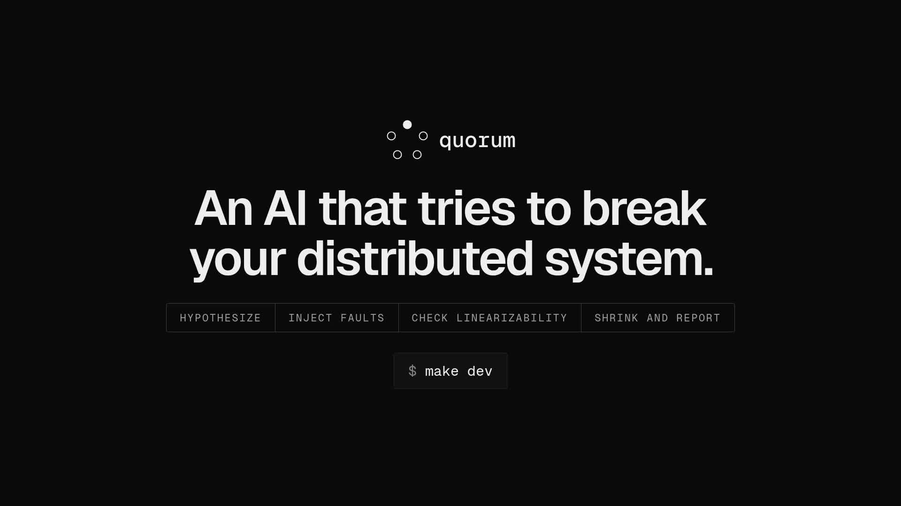
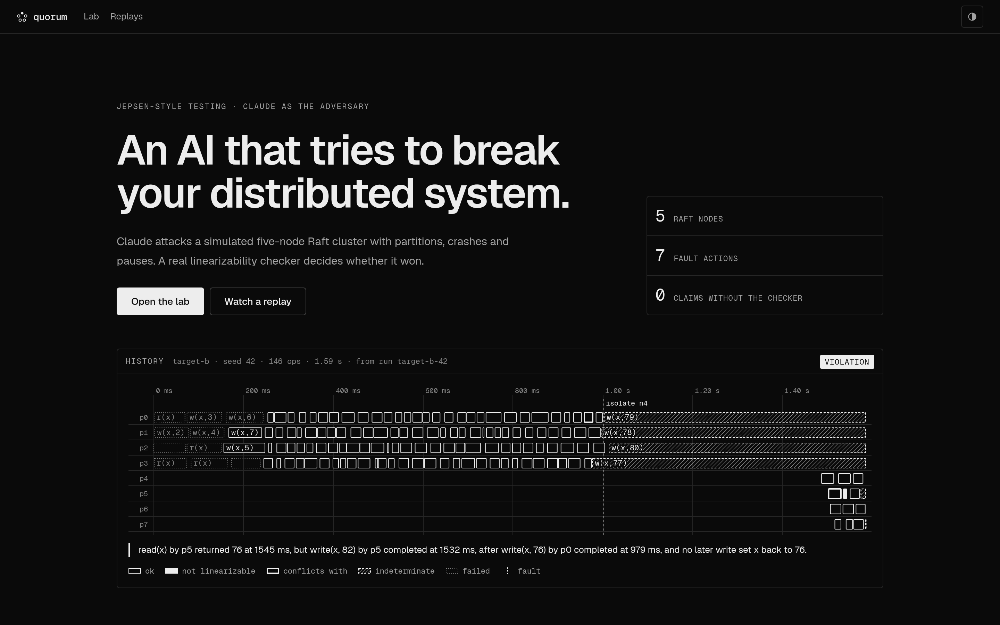
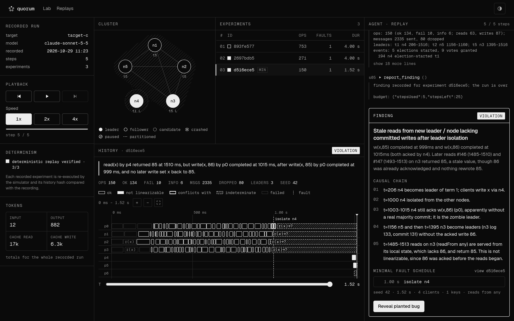
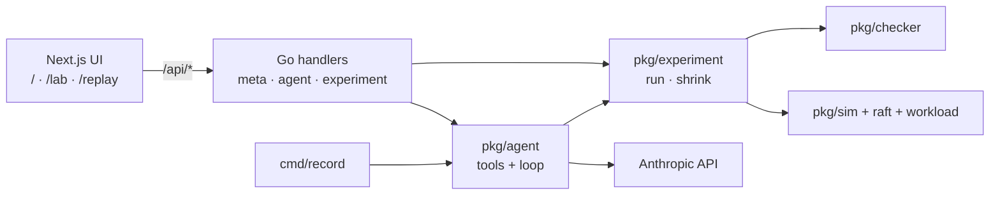

# Quorum

**Live demo:** https://quorum-weld-nu.vercel.app

Quorum is a Jepsen-style lab where Claude plays the adversary. It attacks a simulated five-node Raft key-value store with partitions, crashes, pauses and network faults. A real linearizability checker decides whether it won. Some targets have a planted consistency bug and one is correct, and Claude doesn't know which is which.



## How it works

1. **Hypothesize.** Claude picks a failure mode, for example a stale read after the leader is isolated.
2. **Inject faults.** It runs an experiment: a fault schedule inside a deterministic Go simulator.
3. **Check.** [Porcupine](https://github.com/anishathalye/porcupine) checks the client history for linearizability. Claude can't claim a bug the checker hasn't confirmed.
4. **Shrink and report.** It minimizes the fault schedule and writes the causal chain. On the correct target it should conclude that nothing is broken.



The same spec always produces a byte-identical result. Replays re-run every recorded experiment and verify its hash.

## Architecture



- **Go does all the computing.** Next.js is UI only, with no API routes.
- **Stateless.** Each `/api/agent` call makes one Claude request and runs the tools in Go. The browser holds the conversation, and the server rebuilds experiments from their specs.
- **The API key stays in Go.** It never reaches the browser.

The HTTP contract is in [`docs/api.md`](docs/api.md).

## Run locally

Requires Go (version in `go.mod`), and Node 20+ with npm.

```sh
cp .env.example .env   # set ANTHROPIC_API_KEY
npm install
make dev               # Go on 127.0.0.1:8080, Next.js on :3000
```

Open http://localhost:3000. The landing page and replays work without a key; the live lab needs one.

| Variable | Default | |
|---|---|---|
| `ANTHROPIC_API_KEY` | none | required for the live agent |
| `ANTHROPIC_MODEL` | `claude-sonnet-5-5` | |
| `AGENT_MAX_STEPS` | `30` | clamped to 10–40 |
| `ACCESS_CODE` | empty | when set, `/api/agent` requires it |

`make check` runs every gate: gofmt, `go vet`, `go test -race`, vitest, lint, typecheck and `next build`.

## Recorded runs

```sh
make record TARGET=target-c SEED=42   # writes public/runs/target-c-42.json
```

Runs in `public/runs/` (seed 42):

| Target | Result | Steps |
|---|---|---|
| target-a | no violation (correct answer) | 19 |
| target-b | found | 6 |
| target-c | found | 5 |
| target-d | not found within budget | 22 |
| target-e | found | 5 |

## Design decisions

- **The checker is the only judge.** `report_finding` re-runs the experiment server-side and is rejected unless the verdict is a violation.
- **Determinism makes the agent stateless.** Experiment ids are hashes of their specs, so any result can be recomputed on demand.
- **Named PRNG streams** for network, elections and workload. Removing a fault during shrinking doesn't reshuffle unrelated randomness.
- **Codenames only.** The codename-to-bug mapping lives in one Go file. Nothing the agent or UI sees before a run ends reveals it.
- **A strictly monochrome UI.** Meaning comes from fill, inversion, stroke and hatching: ok is outlined, a violation is inverted and indeterminate is hatched.
- **TypeScript is pinned to `~6.0`**, because `typescript-eslint` doesn't support 6.1+ yet.
